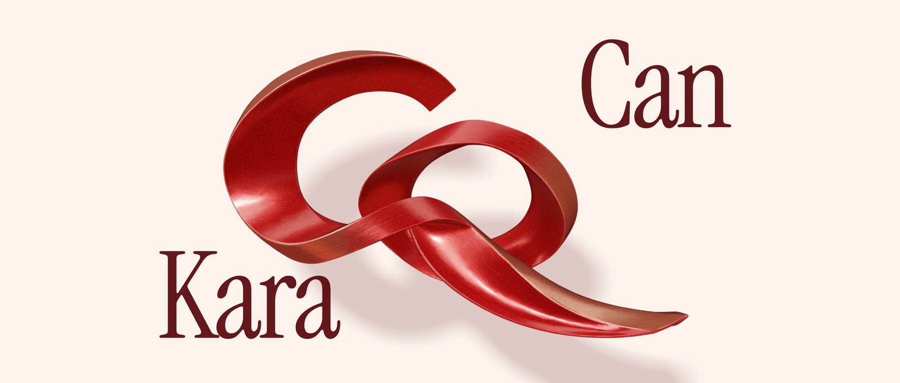

Backend developer working on AI applications and agent systems. 
Java and Python, with the data flow, access control and tests around the model.

- Building the agent runtime of **CAUTRUM**, private pre-alpha · [@cautrumofficial](https://www.instagram.com/cautrumofficial/)
- Founder of **Türk Tech Almanya** · [turktechalmanya.de](https://turktechalmanya.de)
- Java · Python · Spring Boot · FastAPI · PostgreSQL / pgvector · Docker

  &nbsp;
  &nbsp;
  

