

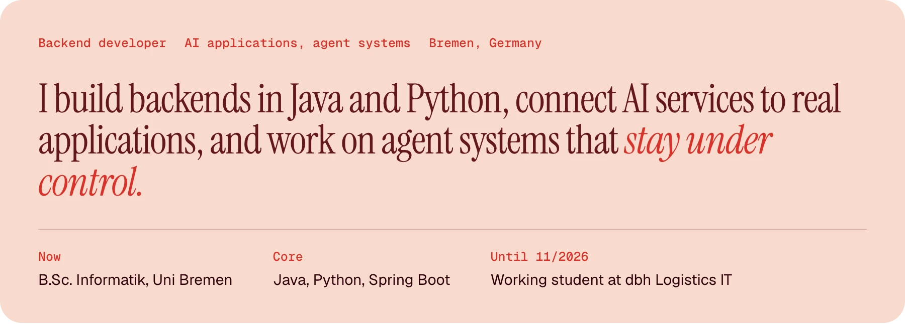

  &nbsp;
  &nbsp;
  <a href="https://www.linkedin.com/in/canquesse">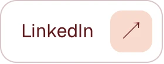</a>&nbsp;
  

 

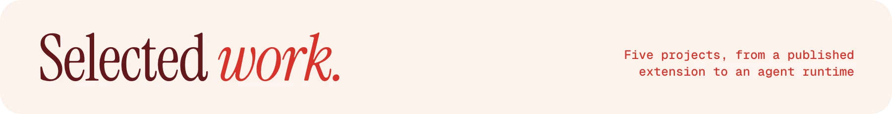

<a href="https://www.instagram.com/cautrumofficial/">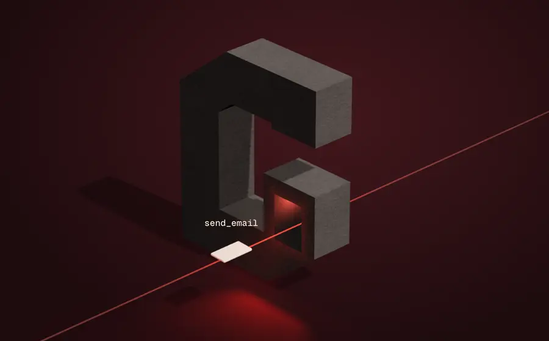</a>

**CAUTRUM** · agent systems, private pre-alpha. The model proposes an action, the application decides whether it runs. I build the Python agent runtime: models, tools, multi-step flows. [@cautrumofficial](https://www.instagram.com/cautrumofficial/)

  <a href="https://canquesse.com/#work">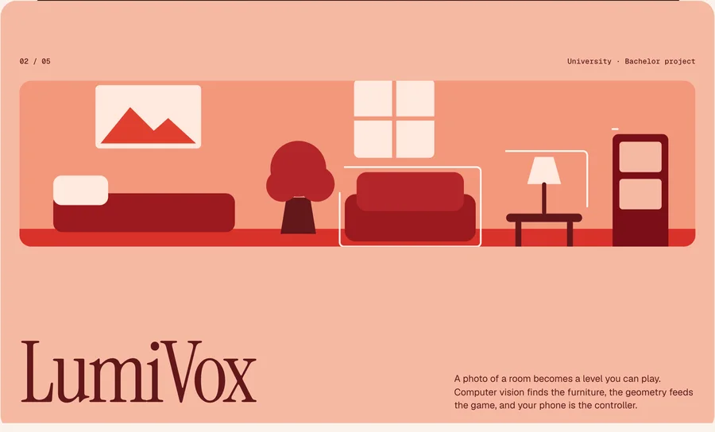</a>
  <a href="https://github.com/canquesse/character-skipper">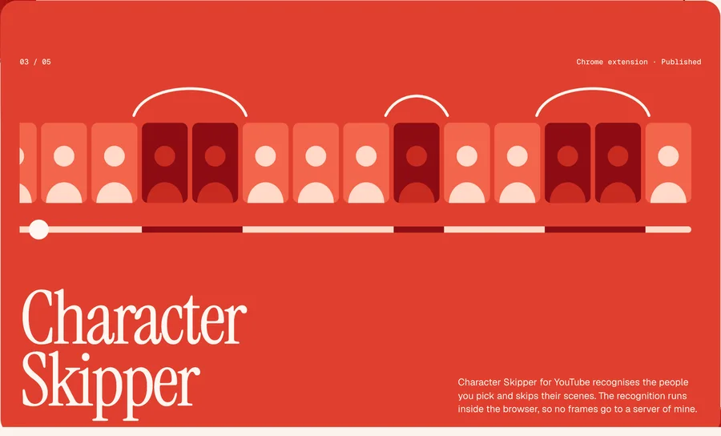</a>
  <a href="https://canquesse.com/#work">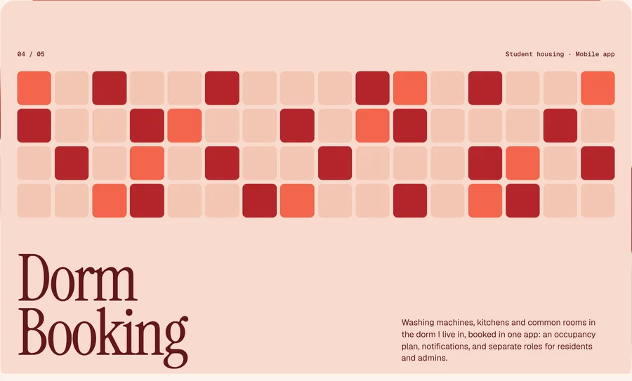</a>
  <a href="https://canquesse.com/#work">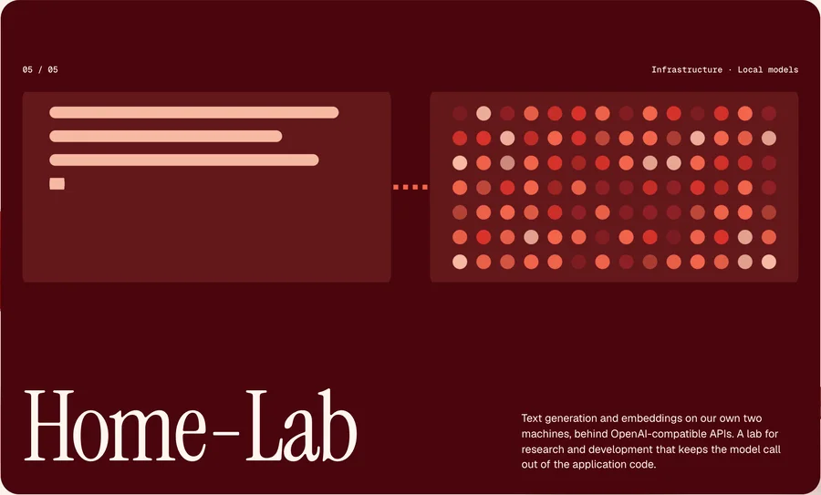</a>

- **LumiVox** · a photo of a room becomes a playable level, with the phone as the controller. Bachelor project, team lead of seven, graded 1.3.
- **Character Skipper** · recognises the people you pick and skips their scenes on YouTube, entirely in the browser. [Chrome Web Store](https://chromewebstore.google.com/detail/character-skipper-for-you/bmgkhekbhlgophgomohpglipnnnladkm) · [source](https://github.com/canquesse/character-skipper)
- **Dorm Booking** · washing machines, kitchens and common rooms of my dorm in one app. React Native, Expo, Supabase.
- **Home-Lab** · text generation and embeddings on two own machines, behind OpenAI-compatible APIs.

 

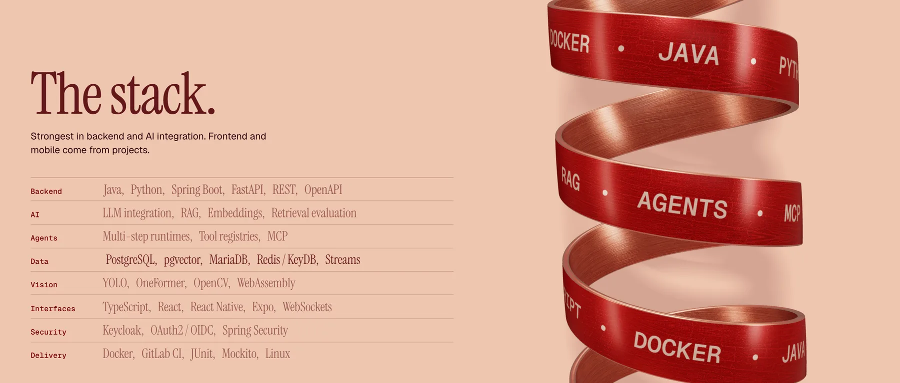

 

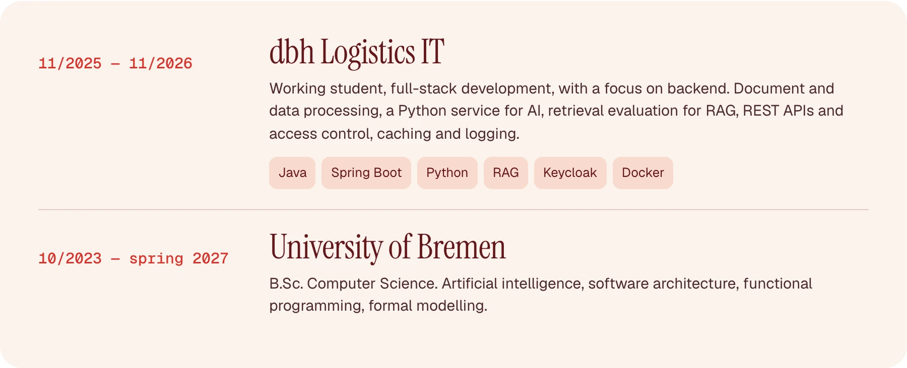

 

<a href="https://turktechalmanya.de">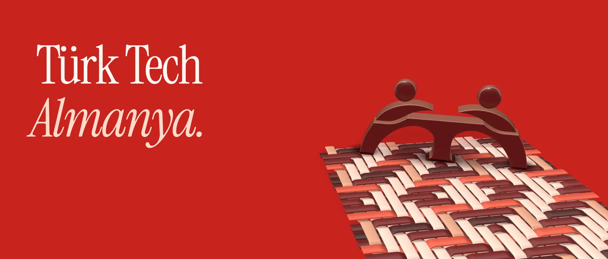</a>

I founded **Türk Tech Almanya**, a network for Turkish-speaking students, engineers and IT people in Germany. [turktechalmanya.de](https://turktechalmanya.de) · [LinkedIn](https://www.linkedin.com/company/turktechalmanya) · [WhatsApp](https://chat.whatsapp.com/BsUvY54znaPEGJWoUmm0Er)

 

<a href="mailto:canquesse@gmail.com">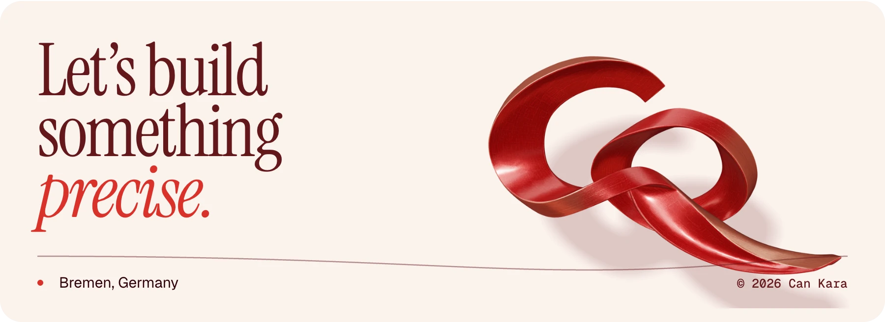</a>
